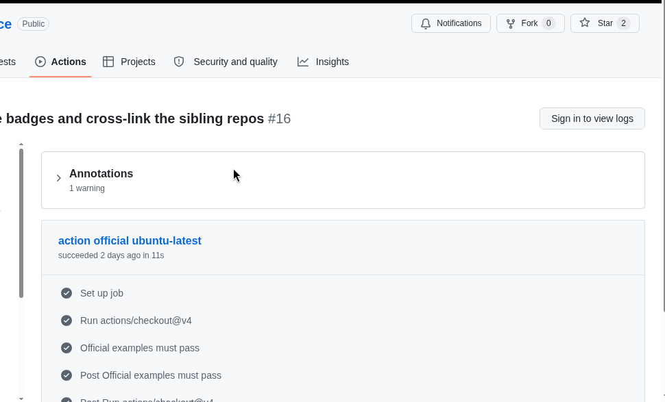
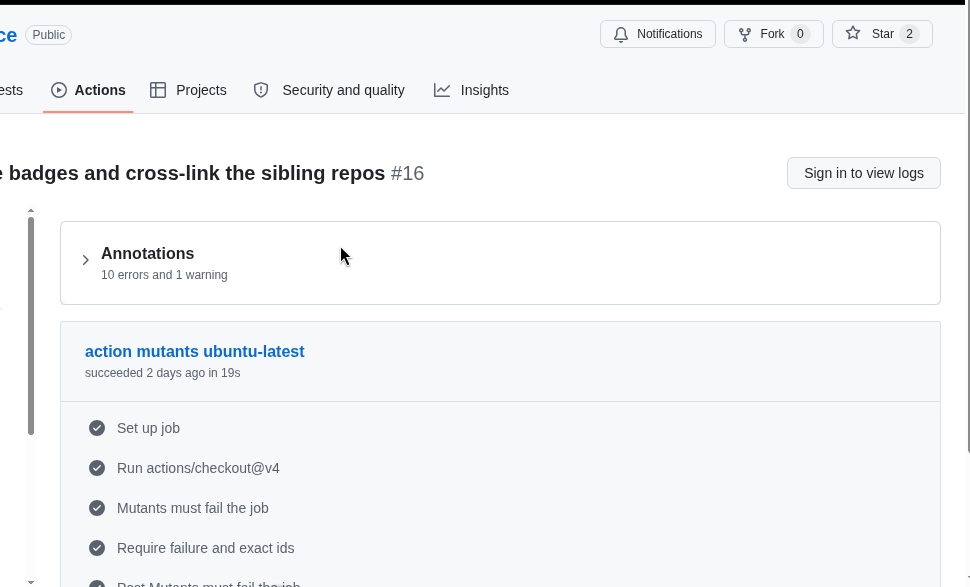

# Validate EN16931 e-invoice

[](https://github.com/facturxapi/validate-einvoice/actions/workflows/selftest.yml) [](https://github.com/facturxapi/validate-einvoice/actions/workflows/upstream-drift.yml) [](https://github.com/marketplace/actions/validate-en16931-e-invoice)

GitHub Action that runs the official ConnectingEurope EN16931 XSLT
artefacts (CII and UBL) on XML invoices and reports every
`svrl:failed-assert`: 1.3.16 by default, 1.3.17 opt-in until it takes
effect on 15/11/26.

A green job means: the vendored stylesheets of the selected version
(1.3.16 by default, 1.3.17 with `version: '1.3.17'`) produced zero
`svrl:failed-assert` on the files you passed. The Action does not call
a remote API, does not read PDF attachments, and does not certify a
document.

## Usage

### Pinning

| Ref | What it is |
|---|---|
| `@v1` | **Mutable** major tag (Marketplace channel). It moves to each new `v1.x.y`; it points at `v1.2.0` (EN16931 1.3.16 by default, 1.3.17 opt-in). |
| `@v1.2.0` | Release tag, never moved once published. Default rules 1.3.16; `version: '1.3.17'` selects 1.3.17. |
| `@v1.1.2` | Previous release, 1.3.16 only (`a805a904f9fa1a7d51db5a4160e863748cc3733d`). |
| Full commit SHA of a release | The frozen tree. Each release's notes give it. |

### EN16931 1.3.17: opt-in until 15/11/26

The Commission's [registry of EN16931 artefacts](https://ec.europa.eu/digital-building-blocks/sites/spaces/DIGITAL/pages/467108974/Registry+of+supporting+artefacts+to+implement+EN16931)
lists 1.3.17 as published on 12/10/26 and in force from 15/11/26. Until
then 1.3.16 stays the default and 1.3.17 is opt-in: set
`version: '1.3.17'`. A later release, `v1.3.0` (planned for 16/11/26),
makes 1.3.17 the default and `@v1` will move to it; `version: '1.3.16'`
will still select 1.3.16.

1.3.17 renames the IGIC and IPSI rules (upstream
[#519](https://github.com/ConnectingEurope/eInvoicing-EN16931/issues/519)),
and not the same way in both syntaxes:

| Rules | 1.3.16 | 1.3.17 CII | 1.3.17 UBL |
|---|---|---|---|
| IGIC (`L`) | `BR-AF-01`…`10` | `BR-IP-01`…`10` | `BR-IG-01`…`10` |
| IPSI (`M`) | `BR-AG-01`…`10` | `BR-IG-01`…`10` | `BR-IP-01`…`10` |

It also removes `CII-SR-471`. A `fail-on` id written for the other
version does not fail the job: the Action prints a `::warning` naming
the id it uses instead, per syntax, and keeps filtering on it
(`CII-SR-471` is ignored with a warning under 1.3.17). An id that the
selected XSLT does not contain under either name is a configuration
error (exit 2), since it could never fire.

Every release from `v1.1.1` on pins third-party Actions by commit SHA,
installs Python dependencies with `--require-hashes`, and refuses
invoices with a DOCTYPE or external entities before Saxon runs.
`v1.0.0` and `v1.1.0` have none of this; do not pin them.

**Same-repo workflow** (this repository checked out):

```yaml
- uses: ./
  with:
    files: invoices/**/*.xml
```

**Downstream consumer**, frozen on a release commit (SHA from the release notes):

```yaml
- uses: facturxapi/validate-einvoice@<full-commit-sha> # v1.2.0
  with:
    files: invoices/**/*.xml
```

**Mutable channel** — `@v1` follows the latest `v1.x.y` (not frozen):

```yaml
- uses: facturxapi/validate-einvoice@v1
  with:
    files: invoices/**/*.xml
```

Copy-paste workflow: [`examples/validate-invoices.yml`](examples/validate-invoices.yml) (`uses: ./` for same-repo).

## Which FacturX repo should I use?

- [validate-einvoice](https://github.com/facturxapi/validate-einvoice) — GitHub Action that runs the official ConnectingEurope EN16931 XSLT artefacts (CII/UBL): 1.3.16 by default, 1.3.17 opt-in.
- [en16931-oracles](https://github.com/facturxapi/en16931-oracles) — Replayable fixtures, receipts and mutants for EN16931 1.3.17, plus a BR-FR pack for the French Flux2 rules (France_RFE `v1.4.0.02` / `v1.4.0.03`).
- [awesome-einvoicing](https://github.com/facturxapi/awesome-einvoicing) — Sourced map of specs, validators, libraries and corpora. Inclusion is not a ranking.

## Public self-test (24 Aug 2026)

Public run on `@v1` as it stood that day (`v1.1.0`, `b364f7c3`, before the hardening shipped in `v1.1.1`). One green workflow: official examples pass; mutants make the Action step fail (expected).

- Run: https://github.com/facturxapi/validate-einvoice/actions/runs/32736104158
- Official examples (ubuntu): [job](https://github.com/facturxapi/validate-einvoice/actions/runs/32736104158/job/97459169913)
- Mutants must fail the Action step (ubuntu): [job](https://github.com/facturxapi/validate-einvoice/actions/runs/32736104158/job/97459170443)





## Local path / `fail-on`

When this repository is checked out as the workflow repo (or vendored):

```yaml
- uses: ./
  with:
    files: invoices/**/*.xml
```


```yaml
# Frozen — full commit SHA of a release
- uses: facturxapi/validate-einvoice@<full-commit-sha> # v1.2.0
  with:
    files: invoices/**/*.xml
    fail-on: failed-assert

# Opt in to EN16931 1.3.17 (in force from 15/11/26)
- uses: facturxapi/validate-einvoice@v1
  with:
    files: invoices/**/*.xml
    version: '1.3.17'

# Mutable — @v1 major tag (follows the latest v1.x.y)
- uses: facturxapi/validate-einvoice@v1
  with:
    files: invoices/**/*.xml
    fail-on: failed-assert

# Report only — same-repo or pinned release SHA
- uses: ./
  with:
    files: invoices/**/*.xml
    fail-on: never

# Fail only if one of these rule ids fires
- uses: ./
  with:
    files: invoices/**/*.xml
    fail-on: BR-CO-15,BR-02
```

## Inputs

| Name | Required | Default | Meaning |
|---|---|---|---|
| `files` | yes | — | Glob(s) of XML invoices, relative to the workspace. Separate several globs with a newline or a comma. Zero matches fail the job (exit 2). |
| `syntax` | no | `auto` | `auto` reads the document-element namespace. `cii` / `ubl` force one syntax and fail if the document does not match. |
| `fail-on` | no | `failed-assert` | `failed-assert`: any `svrl:failed-assert` fails the job. `never`: report only. Comma-separated ids: fail only if one of those ids fires. An id renamed between 1.3.16 and 1.3.17 is translated with a warning; an id the selected XSLT does not contain under either name is a configuration error (exit 2). |
| `version` | no | `1.3.16` | `1.3.16` or `1.3.17` (opt-in until it takes effect on 15/11/26), the two vendored releases. Any other value is a configuration error. |

## Outputs

| Name | Meaning |
|---|---|
| `verdict` | `pass` or `fail` |
| `failed-count` | Number of files with at least one `svrl:failed-assert` |
| `report` | Canonical JSON report (stable keys, no timestamps) |
| `report-sha256` | SHA256 of that JSON |
| `report-path` | Workspace-relative path of the written file (`en16931-report.json`) |

Each file in the JSON has: `path`, `syntax`, `verdict`,
`failed_assert_count`, `failed_assert_ids`, `sha256`, `xslt`,
`xslt_sha256`.

The job also writes GitHub annotations (`::error file=…,title=<id>::`)
and a markdown table on the job summary. Invoice bytes are never logged.

## Reproducibility

The oracle is the pair of official XSLT files, hashed on every run.
A different stylesheet is a different oracle; pins are not auto-updated.

| Version | Syntax | Vendored file | SHA256 |
|---|---|---|---|
| 1.3.17 (opt-in) | CII | `vendor/en16931-1.3.17/xslt/EN16931-CII-validation.xslt` | `0757f07909938b1b297b8356ab7b66406c89f1b342325385d6a2def998c817f0` |
| 1.3.17 (opt-in) | UBL | `vendor/en16931-1.3.17/xslt/EN16931-UBL-validation.xslt` | `fc4e6cfa8596bba0c2abd19038a98960c6ee9fc1f44566787c115efd4f4aca7c` |
| 1.3.16 (default) | CII | `vendor/en16931-1.3.16/xslt/EN16931-CII-validation.xslt` | `0b234dea2bbfee739b7761e607a992c17fab88773014ef56355b6158cfb1cc53` |
| 1.3.16 (default) | UBL | `vendor/en16931-1.3.16/xslt/EN16931-UBL-validation.xslt` | `39f9d282867f1a49e7708d9e29a53da89643e1ee56f10cec1ebcf1277595fcbd` |

Source of those octets: ConnectingEurope `eInvoicing-EN16931` tags
[`validation-1.3.17`](https://github.com/ConnectingEurope/eInvoicing-EN16931/releases/tag/validation-1.3.17)
and `validation-1.3.16` (`en16931-cii-<version>.zip` /
`en16931-ubl-<version>.zip`, inner path `xslt/EN16931-*-validation.xslt`).
Machine-readable pins of the latest release:
[`vendor/upstream.json`](vendor/upstream.json).

The weekly workflow [`.github/workflows/upstream-drift.yml`](.github/workflows/upstream-drift.yml)
re-downloads the latest CII/UBL release and fails if the tag or the
XSLT hashes moved. It never rewrites the pins.

Engine pin: `saxonche==13.0.0` (SaxonC-HE 13.0). The JSON report is
canonical (`sort_keys`, no timestamps, relative paths). Two consecutive
runs of the same files must produce the same `report-sha256`.

Invoices that contain a DOCTYPE are refused before XSLT (stdlib expat).
User bytes are read once; `files[].sha256` is those raw bytes; Saxon
transforms a private snapshot of the same bytes. See
[`docs/LIMITS.md`](docs/LIMITS.md).

`auto` maps:

- `urn:un:unece:uncefact:data:standard:CrossIndustryInvoice:100` → CII
- `urn:oasis:names:specification:ubl:schema:xsd:Invoice-2` or `…CreditNote-2` → UBL

## Local self-test (no GitHub)

```bash
python3 scripts/selftest.py
```

On POSIX you can also run `./scripts/selftest.sh`. Both install
`saxonche==13.0.0`, check the 10 official examples (must be green),
check the 10 mutants (must be red with the ids in
`testdata/MUTANTS.md`), compare two consecutive report hashes, run the
unit tests, and run the identity gate. Any difference is a failure.

## What this does not claim

- Not a national CIUS (France, XRechnung profile, Peppol BIS, …).
  `XRechnung-O.xml` is an official EN16931 category-O example, not a
  CIUS proof.
- Not Factur-X / ZUGFeRD packaging, not PDF/A-3, not veraPDF.
- Not a certification and not a product benchmark.
- Not an official ConnectingEurope Action. It only runs the official
  ConnectingEurope EN16931 XSLT artefacts (1.3.16, 1.3.17).

## Licence

EUPL 1.2 for this Action. The vendored XSLT (`validation-1.3.17` and
`validation-1.3.16`) and the official examples (`validation-1.3.17`) are
ConnectingEurope EN16931 artefacts, also EUPL 1.2, unmodified. Mutants are modified copies (see `NOTICE`).

## See also

- [awesome-einvoicing](https://github.com/facturxapi/awesome-einvoicing) — sourced map of EN16931 / Factur-X / ZUGFeRD / XRechnung specs, validators, and corpora.
- [en16931-oracles](https://github.com/facturxapi/en16931-oracles) — test invoices with signed expected verdicts, aligned with the Commission's ITB validator (16/16). Useful as CI fixtures for this Action.
- For PDF/A-3 (Factur-X/ZUGFeRD) container checks, repair, and the French CTC profile: [facturxapi.com/docs](https://facturxapi.com/docs).
- Walkthrough: adding the official 1.3.16 XSLT to GitHub Actions (YAML, BR-* codes, fixtures that must fail): https://facturxapi.com/blog/valider-ci-github-actions
